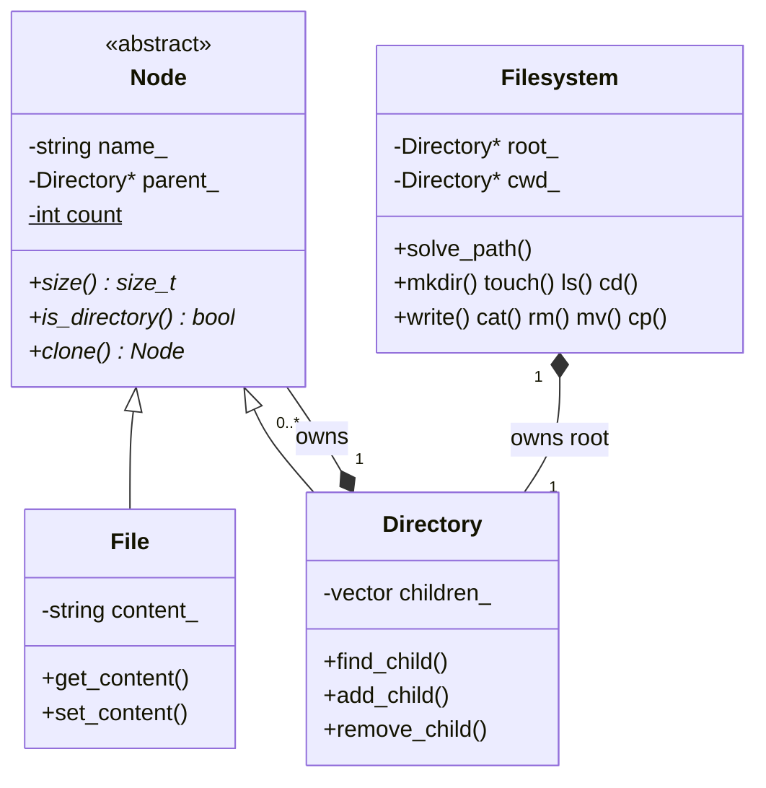

# memfs

**An in-memory file system with a Unix-like shell, written in modern C++.**


## Overview

memfs simulates a hierarchical file system entirely in RAM. Folders and files
are C++ objects linked into a tree, and a small interactive shell lets you
manipulate them with familiar commands: `mkdir`, `cd`, `ls`, `cp -r`, `rm -r`
and more. Nothing is ever written to disk.

The project is a hands-on study of two core C++ topics:

- **Object-oriented design**: an abstract base class, polymorphism through
  virtual functions, and the *virtual constructor* (`clone`) idiom.
- **Manual memory management**: a clear ownership model built on raw
  pointers, and the defensive checks needed to avoid leaks, double frees and
  dangling pointers.

## Features

- Nested folders and files, with recursive size computation
- Absolute and relative paths, including `.` and `..`
- Deep copy of whole subtrees (`cp -r`) and ownership transfer (`mv`)
- Safe deletion: refuses operations that would leave a dangling pointer
- Live object counter (`stats`) to watch memory being allocated and freed
- Verified leak-free with AddressSanitizer

## Getting started

**Requirements:** a C++20 compiler (tested with g++ 13) and CMake 3.20+,
on Linux or WSL.

```bash
git clone https://github.com/saif-hmaied/memfs.git
cd memfs
cmake -S . -B build -G Ninja
cmake --build build
./build/memfs
```

## Usage

| Command | Description |
|---|---|
| `pwd` | Print the current folder |
| `ls [path]` | List a folder (current folder by default) |
| `cd <path>` | Change the current folder |
| `mkdir <path>` | Create a folder |
| `touch <path>` | Create an empty file |
| `write <path> <text...>` | Replace a file's content |
| `cat <path>` | Print a file's content |
| `rm [-r] <path>` | Delete a file, or a folder and its content with `-r` |
| `mv <src> <folder>` | Move a file or folder into another folder |
| `cp [-r] <src> <folder>` | Copy a file, or a whole folder with `-r` |
| `stats` | Show the number of nodes alive in memory |
| `help` / `exit` | Show the command list / quit |

### Example session

```text
memfs:/$ mkdir projects
memfs:/$ cd projects
memfs:/projects$ touch notes.txt
memfs:/projects$ write notes.txt hello world
memfs:/projects$ cat notes.txt
hello world
memfs:/projects$ mkdir src
memfs:/projects$ ls
notes.txt
src/
memfs:/projects$ cd ..
memfs:/$ cp -r projects /projects/src
memfs:/$ stats
nodes in memory: 7
memfs:/$ rm projects
rm: cannot remove projects
memfs:/$ rm -r projects
memfs:/$ stats
nodes in memory: 1
```

The last two `stats` calls show the whole `projects` subtree, including the
copy nested inside it, being freed by a single `rm -r`.

## Architecture



| Layer | Responsibility |
|---|---|
| `Node` | Abstract base: name, parent link, virtual interface, live counter |
| `File` / `Directory` | Concrete node types; a `Directory` owns its children |
| `Filesystem` | Owns the tree, tracks the current folder, resolves paths |
| `main.cpp` | Shell: reads lines, splits words, dispatches commands |

### Ownership model

Every node has exactly **one owner**: its parent folder. Pointers going down
the tree own; pointers going up only observe.

```text
Filesystem ──owns──► "/" ──owns──► projects/ ──owns──► notes.txt
                      ▲                │
                      └──── parent ────┘   (non-owning)
```

- A `Directory` deletes its children in its destructor, and the destructor is
  `virtual`, so `delete` on any folder frees its entire subtree.
- `Filesystem` owns the root; its `cwd` pointer is non-owning.
- Copy constructors are deleted (`= delete`) so two objects can never own
  the same memory.
- `cp` relies on a virtual `clone()`: each type copies itself, which gives a
  correct deep copy without the caller knowing the node's real type.

### Safety checks

Raw pointers make some operations dangerous. Each command validates
everything **before** modifying the tree:

| Operation | Hazard | Protection |
|---|---|---|
| `rm` on the current folder or one of its ancestors | `cwd` would dangle | Refused |
| `rm /` | Root freed twice | Refused |
| `mv` of a folder into itself | Subtree cut off from the tree and leaked | Refused |
| Creating a name that already exists | New node rejected and leaked | Name checked before allocating |

## Memory testing

Build with AddressSanitizer and UndefinedBehaviorSanitizer to detect leaks,
double frees and use-after-free at runtime:

```bash
cmake -S . -B build-asan -G Ninja -DCMAKE_BUILD_TYPE=Debug \
      -DCMAKE_CXX_FLAGS="-fsanitize=address,undefined"
cmake --build build-asan
./build-asan/memfs
```

## Project structure

```text
memfs/
├── CMakeLists.txt
├── include/
│   ├── node.hpp          # abstract base class
│   ├── file.hpp          # File : Node
│   ├── directory.hpp     # Directory : Node, owns children
│   └── filesystem.hpp    # tree owner, path resolution, commands
├── src/
│   └── main.cpp          # interactive shell
└── docs/
    └── demo.gif          # terminal demo
```

## Limitations and roadmap

- No persistence: the tree is lost when the program exits
- `mv` moves into an existing folder but does not rename
- `..` above the root is an error instead of staying at `/`

Planned: migrate to `std::unique_ptr`, symbolic links, `tree` and `find`
commands, undo/redo.
